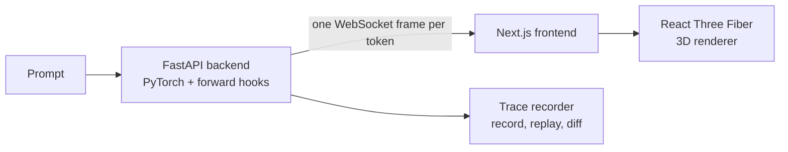
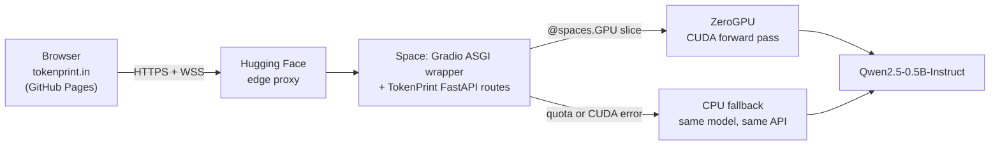

<a name="top"></a>
<p align="center">
  
</p>
<p align="center">
  <b>Watch your model think.</b><br />
  An open-source 3D visual debugger for transformers: run a real forward pass and inspect attention, RoPE, the KV cache and the residual stream as they happen.
</p>
<p align="center">
  <a href="https://tokenprint.in"><b>Live demo</b></a> &nbsp;·&nbsp;
  <a href="#quick-start"><b>Quick start</b></a> &nbsp;·&nbsp;
  <a href="#what-you-can-inspect"><b>Features</b></a> &nbsp;·&nbsp;
  <a href="#hosted-deployment-hugging-face-spaces--zerogpu"><b>Hosted on Hugging Face</b></a> &nbsp;·&nbsp;
  <a href="docs/README.md"><b>Docs</b></a> &nbsp;·&nbsp;
  <a href="wiki/Home.md"><b>Wiki</b></a> &nbsp;·&nbsp;
  <a href="ROADMAP.md"><b>Roadmap</b></a> &nbsp;·&nbsp;
  <a href="https://discord.gg/RbxZBq2Gh"><b>Discord</b></a>
</p>
<p align="center">
  <a href="https://github.com/Sudharsanselvaraj/Token-Print/actions/workflows/ci.yml"></a>
  <a href="LICENSE"></a>
  <a href="https://github.com/Sudharsanselvaraj/Token-Print/stargazers"></a>
  <a href="https://github.com/Sudharsanselvaraj/Token-Print/commits/main"></a>
  <a href="https://huggingface.co/spaces/sudharsan112321/tokenprint-backend"></a>
  <a href="https://discord.gg/RbxZBq2Gh"></a>
  <a href="CONTRIBUTING.md"></a>
</p>
<p align="center">
  <sub><b>BUILT WITH</b></sub><br /><br />
  &nbsp;&nbsp;&nbsp;
  &nbsp;&nbsp;&nbsp;
  &nbsp;&nbsp;&nbsp;
  &nbsp;&nbsp;&nbsp;
  &nbsp;&nbsp;&nbsp;
  &nbsp;&nbsp;&nbsp;
  &nbsp;&nbsp;&nbsp;
  
</p>

---
 
## Why TokenPrint
 
Architecture diagrams show you a transformer. TokenPrint runs one and lets you look inside. Load a real model, run a real forward pass, and watch attention, RoPE, the KV cache and the residual stream as they happen.
 
- **Every number is real.** No `Math.random`, no placeholder tensors. Each value traces to `named_parameters()`, a real forward pass, or the GGUF header, and CI fails if fake data reaches app code. Values are tagged `REAL`, `DERIVED`, `CONCEPTUAL` or `SIMULATION`.
- **A debugger, not a viewer.** Breakpoints, watch expressions, activation ablation with before/after diff, logit lens, induction-head lab, and trace record, replay and branching.
- **Grouped-query attention you can see.** Qwen2.5-0.5B's 14 query heads and 2 KV groups render as geometry clustered exactly that way.
- **Cited, not hand-waved.** Click RoPE, SwiGLU, RMSNorm, GQA or an induction-head pair and get the primary source.
- **Private by default.** GGUF files are parsed client-side. Nothing is uploaded.

## What you can inspect
 
| View | What it shows |
| --- | --- |
| **Architecture** | Every layer, parameter and tensor of the loaded model, from the real `named_parameters()` list. |
| **Generation** | Token-by-token decoding over WebSocket with the real top-k distribution and per-layer activation stats. |
| **Walkthrough** | A guided tour: tokenization, embedding, RMSNorm, self-attention, MLP, softmax and output. |
| **Debugger** | Breakpoints, ablation, activation patching, logit lens and the induction-head lab. |
 
## How it works
 

 
## Supported models
 
<p align="center">
  &nbsp;&nbsp;&nbsp;&nbsp;
  &nbsp;&nbsp;&nbsp;&nbsp;
  &nbsp;&nbsp;&nbsp;&nbsp;
  &nbsp;&nbsp;&nbsp;&nbsp;
  &nbsp;&nbsp;&nbsp;&nbsp;
  
</p>

Qwen 2.5 runs live by default. Llama 2/3/3.2, Gemma, Mistral/Mixtral, DeepSeek (including MoE), Phi and GPT-2/Pythia load as GGUF, and any local `.gguf` works. GPT-2 also runs fully in the browser. Per-family notes are in the [wiki](wiki/Home.md); to add one, see the [developer guide](wiki/Developer-Guide-Adding-a-New-Model.md).
 
## Three ways to run
 
| Mode | Runtime | What you get | Best for |
| --- | --- | --- | --- |
| **Python backend** | PyTorch + Transformers (CUDA, Apple MPS or CPU) | Full instrumentation: attention, hidden states, ablation, patching | Real debugging |
| **Quantized GGUF** | `llama.cpp` via `llama-cpp-python` | Real quantized token probabilities and KV-cache accounting | Inspecting quantized weights |
| **In the browser** | GPT-2 on WebGPU + ONNX Runtime | Fully client-side, greedy decoding, desktop only | Zero-install demos |
 
## Quick start
 
Requires Python 3.11 or 3.12 and Node 20.9+.
 
```bash
git clone https://github.com/Sudharsanselvaraj/Token-Print.git
cd Token-Print
python3 scripts/start.py
```
 
The launcher installs dependencies, downloads `Qwen2.5-0.5B-Instruct` with progress, starts the backend and frontend, and waits until the model is ready. Then open <http://localhost:3000>.
 
No GPU or no time? Choose **Try a recorded demo** on the home page to replay a real trace offline. Stuck on setup? See [local setup and troubleshooting](docs/local-setup.md) or ask in the [Discord](https://discord.gg/RbxZBq2Gh).
 
<details>
<summary>Manual setup</summary>

```bash
# backend (Apple MPS, CUDA or CPU fallback)
cd backend && python3 -m venv .venv --system-site-packages
source .venv/bin/activate && pip install -r requirements.txt
python -m uvicorn app.main:app --app-dir . --port 8000
```
 
```bash
# frontend
cd frontend && npm install && npm run dev   # http://localhost:3000
```
 
For quantized GGUF execution: `pip install -r backend/requirements-gguf.txt`. To force CPU: `TOKENPRINT_DEVICE=cpu`.
 
</details>

## Hosted deployment: Hugging Face Spaces + ZeroGPU
 
The public site at [tokenprint.in](https://tokenprint.in/) is a static Next.js export on GitHub Pages. It talks to a FastAPI backend running as a [Hugging Face Space](https://huggingface.co/spaces/sudharsan112321/tokenprint-backend) with ZeroGPU.
 

 
| Topic | Behavior |
| --- | --- |
| **Default model** | `Qwen/Qwen2.5-0.5B-Instruct`, loaded once at startup. |
| **GPU path** | Forward-pass, debug, ablation, patching and generation run inside `@spaces.GPU` slices (60 s). |
| **Quota** | ZeroGPU has a daily per-user quota. When it is exhausted, or CUDA fails, the request falls back to CPU instead of erroring. Results are the same, only slower. |
| **Cold starts** | A sleeping Space takes roughly 10 to 25 seconds to wake. |
| **GGUF** | Quantized generation is a local feature: the hosted Space does not ship `llama-cpp-python`. GGUF files are still parsed in your browser. |
| **Storage** | The Space disk is ephemeral. Files placed in `data/gguf` are lost on restart. |
| **Models** | Only the default model is served. The [compatibility registry](docs/API_DEPLOYMENT_REFERENCE.md) (`GET /api/model/compatibility`) lists what each other checkpoint has and has not been tested for. |
 
Point your own frontend at any backend with `NEXT_PUBLIC_API_URL`. Full details: [Hugging Face deployment guide](docs/HUGGINGFACE_DEPLOYMENT_GUIDE.md), [limitations](docs/DEPLOYMENT_LIMITATIONS.md), [post-deployment verification](docs/POST_DEPLOYMENT_VERIFICATION.md).
 
## Why you can trust the numbers
 
- `GET /architecture` reports **494,032,768** parameters on live Qwen, the exact sum of all **290** real tensors.
- The op catalog lists **219 ops** in true forward order, matching the actual module graph.
- Five independent verification scripts and a CI regression gate back this up: [docs/verification.md](docs/verification.md).

Known limits, stated plainly:
 
- Quantized GGUF inference is real, but `llama.cpp` exposes no per-layer activations, so layer lighting is disabled there instead of faked.
- Attention weight is not causal proof. It is a signal, not evidence the model needed that token ([details](docs/visual-mapping.md#causality-warning)).
- Per-layer timings are unsynchronized wall-clock on MPS and CUDA, and are badged `PROXY · NOT MS` when unbacked.
- Browser inference currently covers GPT-2 on desktop WebGPU with greedy decoding.

If you find a wrong number, that is a top-priority bug.
 
## Repository layout
 
```text
backend/     FastAPI service: model engine, adapters, GGUF engine, tracing, tests
frontend/    Next.js + React Three Fiber app, unit and visual-regression tests
docs/        Architecture, API, deployment, verification, visual mapping
wiki/        User guide, transformer concepts, developer guide
scripts/     Launcher, trace tools, demo generation
fixtures/    Reference traces and tiny test models
deploy/      Self-hosting scripts
```
 
## Documentation
 
[Architecture](docs/architecture.md) · [API reference](docs/api.md) · [Visual mapping](docs/visual-mapping.md) · [GGUF format](docs/gguf-format.md) · [Browser inference](docs/browser-inference.md) · [Experiments](docs/experiments.md) · [Development](docs/development.md) · [Deployment](docs/deployment.md) · [Roadmap](ROADMAP.md)
 
## Community

<div align="center">
  <a href="https://discord.gg/RbxZBq2Gh">
    
  </a>
  <h3><a href="https://discord.gg/RbxZBq2Gh">Join the TokenPrint community on Discord</a></h3>
  <sub>Questions · Bug reports · Shared traces · Feature ideas · Show and tell</sub>
  <br /><br />
  <a href="https://discord.gg/RbxZBq2Gh"></a>
</div>

## Contributing
 
First-timers are welcome. Pick a task from [GOOD_FIRST_ISSUES.md](GOOD_FIRST_ISSUES.md) or the [open issues](https://github.com/Sudharsanselvaraj/Token-Print/issues), read [CONTRIBUTING.md](CONTRIBUTING.md), and open a PR. Working examples to copy from are in [docs/contributor-examples.md](docs/contributor-examples.md).
 
The one rule for every change: every number shown must be real.
 
<!-- CONTRIBUTORS:START -->
<div align="center">
  <a href="https://github.com/Sudharsanselvaraj/Token-Print/graphs/contributors"><strong>24 contributors</strong></a>
  <div align="center">
    <a href="https://github.com/Sudharsanselvaraj" title="Sudharsanselvaraj"></a>
    <a href="https://github.com/ManoShruthiS" title="ManoShruthiS"></a>
    <a href="https://github.com/Vedhiga" title="Vedhiga"></a>
    <a href="https://github.com/shanky-ux" title="shanky-ux"></a>
    <a href="https://github.com/Ritik-The-Dev" title="Ritik-The-Dev"></a>
    <a href="https://github.com/Sew-a" title="Sew-a"></a>
    <a href="https://github.com/Kesavaraja67" title="Kesavaraja67"></a>
    <a href="https://github.com/nihal29055" title="nihal29055"></a>
    <a href="https://github.com/sairam-s0" title="sairam-s0"></a>
    <a href="https://github.com/KrishnaKumar-ADS" title="KrishnaKumar-ADS"></a>
    <a href="https://github.com/Mayank-agrawal155" title="Mayank-agrawal155"></a>
    <a href="https://github.com/Shivamyadav1312" title="Shivamyadav1312"></a>
    <a href="https://github.com/Sriram-Selvaperumal" title="Sriram-Selvaperumal"></a>
    <a href="https://github.com/Hari5259" title="Hari5259"></a>
    <a href="https://github.com/AbinanthanS" title="AbinanthanS"></a>
    <a href="https://github.com/challenge456" title="challenge456"></a>
    <a href="https://github.com/Deepashaa24" title="Deepashaa24"></a>
    <a href="https://github.com/jk-pvt" title="jk-pvt"></a>
    <a href="https://github.com/Kajal429" title="Kajal429"></a>
    <a href="https://github.com/karansakure123" title="karansakure123"></a>
    <a href="https://github.com/ris422" title="ris422"></a>
    <a href="https://github.com/Sarvatha02" title="Sarvatha02"></a>
    <a href="https://github.com/SYDEFACTOR1" title="SYDEFACTOR1"></a>
    <a href="https://github.com/vigasinii" title="vigasinii"></a>
  </div>
  <sub><a href="https://github.com/Sudharsanselvaraj">Sudharsanselvaraj</a>, <a href="https://github.com/ManoShruthiS">ManoShruthiS</a>, <a href="https://github.com/Vedhiga">Vedhiga</a>, <a href="https://github.com/shanky-ux">shanky-ux</a>, <a href="https://github.com/Ritik-The-Dev">Ritik-The-Dev</a>, <a href="https://github.com/Sew-a">Sew-a</a>, <a href="https://github.com/Kesavaraja67">Kesavaraja67</a>, <a href="https://github.com/nihal29055">nihal29055</a>, <a href="https://github.com/sairam-s0">sairam-s0</a>, <a href="https://github.com/KrishnaKumar-ADS">KrishnaKumar-ADS</a>, <a href="https://github.com/Mayank-agrawal155">Mayank-agrawal155</a>, <a href="https://github.com/Shivamyadav1312">Shivamyadav1312</a>, <a href="https://github.com/Sriram-Selvaperumal">Sriram-Selvaperumal</a>, <a href="https://github.com/Hari5259">Hari5259</a>, <a href="https://github.com/AbinanthanS">AbinanthanS</a>, <a href="https://github.com/challenge456">challenge456</a>, <a href="https://github.com/Deepashaa24">Deepashaa24</a>, <a href="https://github.com/jk-pvt">jk-pvt</a>, <a href="https://github.com/Kajal429">Kajal429</a>, <a href="https://github.com/karansakure123">karansakure123</a>, <a href="https://github.com/ris422">ris422</a>, <a href="https://github.com/Sarvatha02">Sarvatha02</a>, <a href="https://github.com/SYDEFACTOR1">SYDEFACTOR1</a>, <a href="https://github.com/vigasinii">vigasinii</a></sub>
  <br />
  <sub>Every person who has contributed to Token-Print. Thank you.</sub>
</div>
<!-- CONTRIBUTORS:END -->

## License
 
[MIT](LICENSE) &copy; [Sudharsan Selvaraj](https://github.com/Sudharsanselvaraj). If TokenPrint helps you, you can [support the project](https://buymeacoffee.com/sudharsanselvaraj).
 
<p align="center">
  <a href="https://star-history.com/#Sudharsanselvaraj/Token-Print&Date">
    
  </a>
  <br />
  <sub><a href="#top">Back to top</a></sub>
</p>
