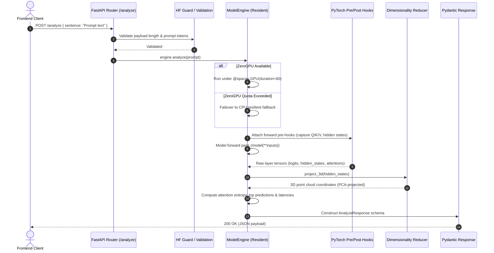

# TokenPrint — Backend Architecture & Service Design

**Status:** Current Production Backend  
**Module Root:** `backend/app/`  
**Framework:** FastAPI 0.115+ / Uvicorn / Starlette / Gradio 6 ASGI  
**Runtime:** Python 3.11 / 3.12 (Strictly Verified)  

---

## 1. Backend Service Structure

The TokenPrint backend executes as an asynchronous ASGI application providing high-throughput REST endpoints, persistent WebSocket channels, and a resident PyTorch machine learning engine.

```
backend/app/
├── main.py                     # Primary FastAPI application, routing table & lifespan
├── model.py                    # ModelEngine: PyTorch forward pass, hooks, and KV cache
├── ablation.py                 # Ablation context manager & ActivationPatch hook system
├── reduce.py                   # Dimensionality reduction (3D PCA projection, causal scores)
├── schemas.py                  # Pydantic v2 data models, requests, responses, and schemas
├── hf_guard.py                 # Outbound SSRF guard, domain allowlist, and input sanitization
├── collab.py                   # Collaborative presence room manager & WebSocket broadcaster
├── debug.py                    # Operation graph debugging & intermediate tensor inspector
├── trace.py                    # Strict versioned trace parser & replay validator
├── gguf_engine.py              # Local GGUF quantized model loader & metadata parser
├── gguf_cache.py               # GGUF file upload manager and disk cache controller
└── inference/
    ├── base.py                 # Abstract ModelAdapter & InferenceBackend interfaces
    ├── registry.py             # Active adapter resolution & factory registry
    ├── capabilities.py         # Static capability matrices & inspection logic
    ├── compatibility_engine.py # Dynamic 4-level model compatibility evaluation engine
    ├── compatibility_registry.py # Canonical verification records across candidate checkpoints
    ├── error_classification.py # Typed error classifications & resilient fallback triggers
    └── adapters/
        ├── base.py             # Base causal LM adapter with standard hook definitions
        ├── qwen.py             # Qwen 2 / 2.5 architecture adapter (GQA, RoPE, SwiGLU)
        ├── llama.py            # LLaMA 2 / 3 / 3.1 / 3.2 architecture adapter
        ├── gpt2.py             # Classical GPT-2 architecture adapter
        ├── mistral.py          # Mistral 7B & sliding-window attention adapter
        ├── mixtral.py          # Mixtral 8x7B MoE sparse routing adapter
        ├── gemma.py            # Gemma & Gemma 2 adapter (logit soft-capping)
        ├── deepseek.py         # DeepSeek V2/V3 MoE architecture adapter
        └── generic.py          # Fallback adapter for Hugging Face AutoModelForCausalLM
```

---

## 2. Request Lifecycle & Routing Table

When an inference request arrives at `POST /analyze` or `POST /debug/analyze`:



---

## 3. Core API Endpoints

### 3.1 Diagnostics & Resident Model Status
- `GET /health`: Liveness and readiness probe reporting resident engine status and active device.
- `GET /model-info`: Architectural parameters of resident model (num_layers, num_heads, hidden_size).
- `GET /architecture`: Full 3D computation graph nodes, tensor dimensions, and edge topology.

### 3.2 Hugging Face Discovery & Compatibility
- `GET /api/hub/models`: Dynamic search across Hugging Face Hub with sorting, pagination, and caching.
- `GET /api/hub/models/{model_id}/compatibility`: 4-level capability evaluation and VRAM estimation.
- `GET /api/hf/curated`: Curated candidate models optimized for immediate visualization.
- `GET /api/model/compatibility`: Static verified model compatibility records.

### 3.3 Inference & Mechanistic Interpretability
- `POST /analyze`: Forward pass with attention extraction, 3D residual stream trajectory, and top logits.
- `POST /debug/analyze`: Intermediate tensor activation extraction across all operations.
- `POST /ablate/analyze`: Selective head zeroing and intermediate layer ablation.
- `POST /patch/analyze`: Activation patching replacing corrupted prompt activations with clean activations.
- `POST /analyze/similarity`: Cosine similarity matrix across multiple prompt sentences.
- `POST /rag/analyze`: RAG attribution scores and ungrounded generation hallucination flags.

### 3.4 Persistent Real-Time WebSockets
- `WS /ws/generate`: Autoregressive generation stream emitting token packets, draft status, and sliding-window KV cache frames.
- `WS /ws/collab/{room_id}`: Real-time room presence and 3D spatial cursor broadcasting.

---

## 4. Backend Capability Inventory

- **Resident Engine Loading**: `IMPLEMENTED` — Synchronous startup download and caching of candidate checkpoint.
- **Eager Attention Extraction**: `IMPLEMENTED` — Forces `attn_implementation="eager"` on Hugging Face models.
- **ZeroGPU CUDA Slicing**: `IMPLEMENTED` — Dynamic `@spaces.GPU` slice duration timers on Hugging Face Spaces.
- **Resilient CPU Fallback**: `IMPLEMENTED` — Automated fallback on CUDA unavailability or quota limits.
- **WebSocket Streaming**: `IMPLEMENTED` — Async token-by-token emission with connection state handling.
- **Collaborative Presence**: `IMPLEMENTED` — In-memory room presence with viewer/driver role enforcement.
- **SSRF Outbound Guard**: `IMPLEMENTED` — Domain allowlisting and IP network range inspection.
- **Distributed Multi-GPU Serving**: `NOT SUPPORTED` — TokenPrint is designed for single-node / edge visualization.
