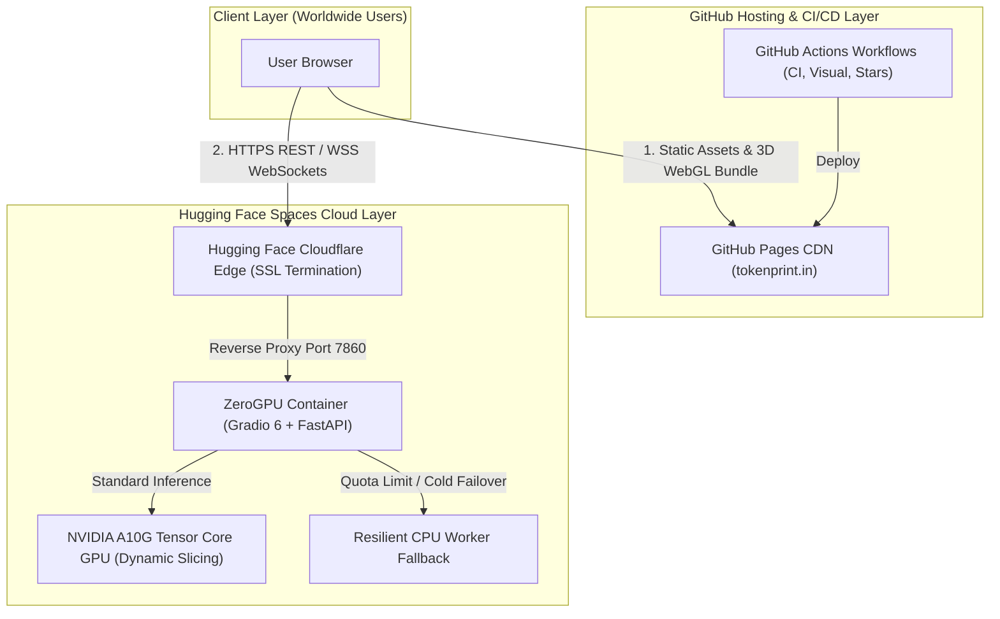

# TokenPrint — Deployment Architecture & Infrastructure Design

**Status:** Current Production Deployment  
**Live Backend Space:** `https://huggingface.co/spaces/sudharsan112321/tokenprint-backend`  
**Live Backend Domain:** `https://sudharsan112321-tokenprint-backend.hf.space`  
**Live Frontend Production:** `https://tokenprint.in` (GitHub Pages / DNS Verified)  
**Compute Tiers:** NVIDIA ZeroGPU (`zero-a10g`) + Resilient CPU Failover  

---

## 1. Multi-Tier Production Topology

---

## 2. Hugging Face Spaces & ZeroGPU Configuration

TokenPrint runs inside a Gradio-based Space container on Hugging Face Spaces:
- **SDK**: Gradio 6.11.0
- **App File**: `app.py`
- **Routing Integration**: Prepending FastAPI routes to Gradio ASGI router to circumvent Gradio 6 SSR route interception.
- **Dynamic GPU Allocation**: `@spaces.GPU(duration=60)` wraps CUDA-intensive inference operations (`analyze`, `debug_analyze`, `generate_steps`).
- **Resilient CPU Fallback**: When `ZeroGPUQuotaExceeded` occurs or CUDA hardware is unavailable, the backend automatically diverts execution to `cpu_fallback` without dropping client connections.
- **Cold Starts**: ZeroGPU instances dynamically spin up from cold storage in ~20-25 seconds; health probes report `model_loaded: false` until model weights are in memory.

---

## 3. Deployment Capability Inventory

| Deployment Modality | Status | Details |
| :--- | :--- | :--- |
| **Local Script Launcher** | `IMPLEMENTED` | `python3 scripts/start.py` launches Uvicorn backend + Next.js dev server. |
| **Hugging Face Spaces** | `IMPLEMENTED` | Live on `sudharsan112321/tokenprint-backend` with ZeroGPU and CPU fallback. |
| **GitHub Pages** | `IMPLEMENTED` | Static export deployed via `.github/workflows/deploy.yml` with custom domain. |
| **Docker Container** | `PLANNED` | Standalone Dockerfile drafted; Space currently uses Gradio SDK native environment. |
| **Kubernetes Cluster** | `NOT SUPPORTED`| TokenPrint is designed for single-node / edge compute architectures. |
