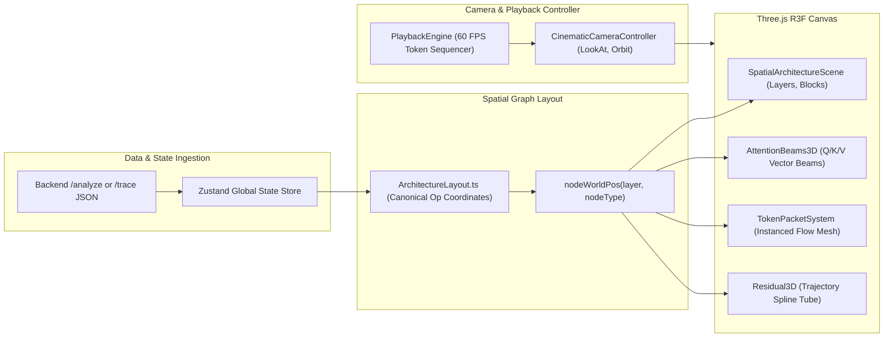

# TokenPrint — Frontend Architecture & Visualization Pipeline

**Status:** Current Production Frontend  
**Framework:** Next.js 15 (App Router, Static Export Target)  
**Language:** TypeScript 5.5+  
**Graphics & 3D:** Three.js / React Three Fiber / Drei  
**State Store:** Zustand (Zero-Redux Architecture)  
**Styling:** Tailwind CSS / CSS Modules / Custom Monochrome Design System  

---

## 1. Frontend Architecture & Directory Layout

The frontend is structured to maintain strict separation between the 3D WebGL render loop, reactive DOM state, and the technical documentation portal:

```
frontend/
├── app/
│   ├── layout.tsx              # Root HTML layout with GlobalHeader & ModalRoot
│   ├── page.tsx                # High-performance landing page (hero, marquee, features)
│   ├── app/                    # Primary interactive 3D application (/app?mode=...)
│   └── docs/                   # Developer documentation platform (/docs/...)
├── components/
│   ├── GlobalHeader.tsx        # Persistent top navbar with route-mode highlighting
│   ├── AppShell.tsx            # Main application workspace layout and keyboard listeners
│   ├── Scene.tsx               # Primary 3D WebGL viewport canvas
│   ├── PlaybackEngine.tsx      # 60 FPS deterministic step sequencer and token clock
│   ├── camera/                 # CinematicCameraController & GlobalCameraController
│   ├── landing/                # LandingPage, EcosystemLogos marquee, and visuals
│   ├── docs/                   # DocsAppShell, DocsNav, DocsOnThisPage, DocsCode
│   ├── scenes/                 # 3D spatial scenes (SpatialArchitectureScene, Attention3D, etc.)
│   └── ui/                     # Reactive overlays (HFModelPicker, DebuggerPane, ArchitecturePanel)
└── lib/
    ├── store/                  # Zustand store slices (trace, playback, collab, audio)
    ├── api.ts                  # REST API client & error handling
    ├── hfHub.ts                # Client-side Hugging Face Hub search fallback
    ├── routeMode.ts            # Canonical route mode normalizer (explorer, generation, etc.)
    └── assets.ts               # basePath-aware asset resolver for GitHub Pages
```

---

## 2. 3D WebGL Visualization Pipeline

The 3D visualization is driven by React Three Fiber with procedural shaders, instanced meshes, and deterministic spatial placement.



---

## 3. Application Route Modes

TokenPrint organizes its interactive views through canonical route modes (`/app?mode=<mode>`):

| Route Mode | Normalized Parameter | Primary Visual Scene | Description |
| :--- | :--- | :--- | :--- |
| **Explorer** | `explorer` | `SpatialArchitectureScene` | Structural 3D model op graph, parameter distribution, and tensor topology. |
| **Generation** | `generation` | `Attention3D` / `LMHead3D` | Real-time autoregressive generation, KV cache accumulation, and token stream. |
| **Walkthrough** | `walkthrough` | `CinematicCameraController` | Curated, step-by-step guided architectural tour through transformer components. |
| **Debugger** | `debugger` | `DebuggerPane` / `Residual3D` | Layer-by-layer intermediate tensor inspection, head ablation, and activation patching. |

---

## 4. Frontend Capability Inventory

- **Static HTML Export**: `IMPLEMENTED` — Fully static `next export` hosted on GitHub Pages or custom domain.
- **basePath Awareness**: `IMPLEMENTED` — Dynamic asset resolution under root domain or `/Token-Print` prefix.
- **Zero-SSR Three.js**: `IMPLEMENTED` — Server-side WebGL bundling avoided via dynamic import with `ssr: false`.
- **Keyboard Navigation**: `IMPLEMENTED` — Space (Play/Pause), Left/Right (Step), R (Reset), 1-4 (Mode Switch).
- **Client Hub Fallback**: `IMPLEMENTED` — Direct CORS queries to `huggingface.co/api/models` when backend is unreachable.
- **Multimodal Audio**: `IMPLEMENTED` — Real-time Web Audio API frequency synthesis proportional to logits entropy.
