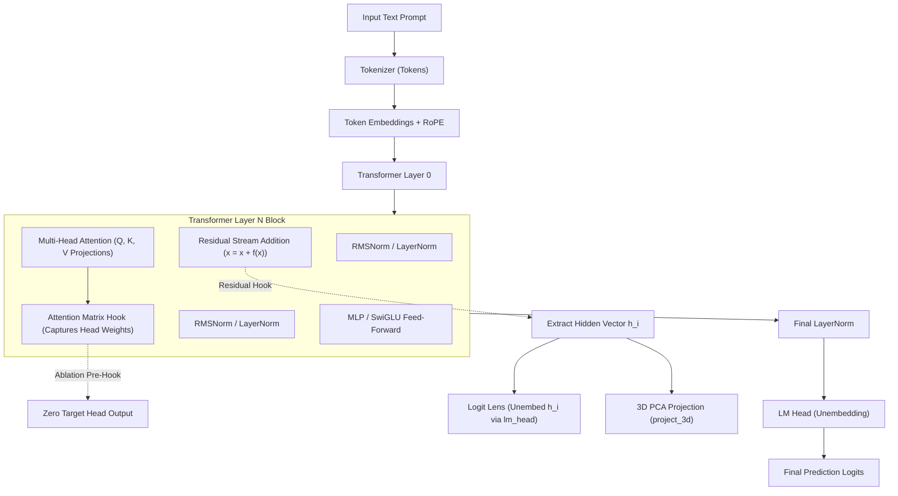

# TokenPrint — Mechanistic Interpretability & Instrumentation Pipeline

**Status:** Current Production Pipeline  
**Module Root:** `backend/app/ablation.py`, `backend/app/debug.py`, `backend/app/model.py`  
**Methodologies:** Attention Extraction, Residual Projections, Logit Lens, Head Ablation, Layer Ablation, Activation Patching  

---

## 1. Instrumentation Architecture

TokenPrint attaches non-destructive PyTorch forward hooks to intermediate transformer modules to observe and intervene upon internal representations during inference:

---

## 2. Core Instrumentation Methodologies

### 2.1 Attention Matrix Extraction
- **Implementation**: Eager multi-head attention extraction (`output_attentions=True`).
- **Data Extracted**: Shape `[batch, num_heads, seq_len, seq_len]` per layer.
- **Visualization**: Rendered as interactive 2D heatmaps and 3D attention beams connecting source and target token landmarks.

### 2.2 Residual Stream Trajectory (3D PCA)
- **Implementation**: Captures hidden state vectors $h_\ell \in \mathbb{R}^{d_{\text{model}}}$ across all layers $\ell \in [0, L]$.
- **Dimensionality Reduction**: `project_3d` computes PCA projections to map $d_{\text{model}}$ down to $\mathbb{R}^3$, generating a continuous spatial trajectory through computational space.

### 2.3 Logit Lens
- **Implementation**: Takes intermediate residual state $h_\ell$, scales via `final_layernorm`, and projects through the unembedding matrix $W_U$:
  $$\text{logits}_\ell = \text{RMSNorm}(h_\ell) \cdot W_U^T$$
- **Insight**: Reveals which candidate tokens the model considers most likely at intermediate layer depths before the final layers.

### 2.4 Attention Head Ablation
- **Implementation**: `Ablation` context manager attaches forward pre-hooks to attention projection modules.
- **Intervention**: Masks specific attention heads by zeroing out their output slices prior to residual addition:
  $$\text{head}_h(x) = \mathbf{0}$$
- **Verification**: Measures output shift (top token divergence and probability delta) to quantify head criticality.

### 2.5 Transformer Layer Ablation
- **Implementation**: Bypasses entire intermediate transformer blocks by passing the input residual vector unchanged:
  $$x_{\ell+1} = x_\ell$$
- **Insight**: Tests whether intermediate layers perform redundant computation or represent essential circuit transformations.

### 2.6 Activation Patching (Causal Interventions)
- **Implementation**: Runs clean prompt $P_{\text{clean}}$ and corrupted prompt $P_{\text{corrupted}}$.
- **Hook Swap**: Injects the clean activation from layer $\ell$ at token position $t$ into the corrupted forward pass:
  $$h_\ell^{\text{corrupted}}[t] \leftarrow h_\ell^{\text{clean}}[t]$$
- **Causal Metric**: Evaluates indirect effect by measuring recovery of the clean target logit probability.

---

## 3. Instrumentation Capability Inventory

| Capability | Status | Implementation Details |
| :--- | :--- | :--- |
| **Attention Capture** | `IMPLEMENTED` | Full layer-wise multi-head attention weights captured natively. |
| **Residual Stream PCA** | `IMPLEMENTED` | 3D projection (`project_3d`) with explained variance metrics. |
| **Logit Lens** | `IMPLEMENTED` | Normalized intermediate unembedding projection per layer. |
| **Head Ablation** | `IMPLEMENTED` | Dynamic head masking context manager with forward pre-hooks. |
| **Layer Ablation** | `IMPLEMENTED` | Block bypass identity pass-through. |
| **Activation Patching** | `IMPLEMENTED` | Position-specific residual replacement across prompt pairs. |
| **Circuit Discovery** | `EXPERIMENTAL` | Automated induction head detection and circuit tracing. |
| **Cross-Layer Probes** | `PLANNED` | Linear probing across intermediate representations. |
