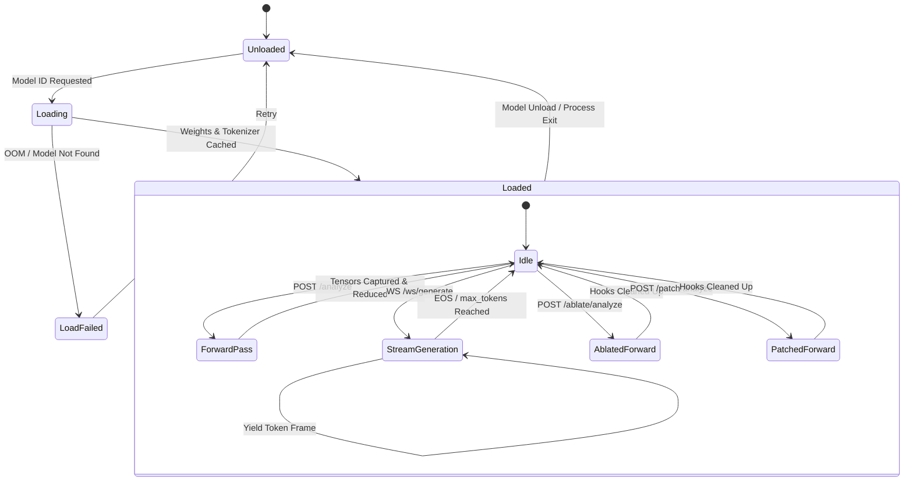
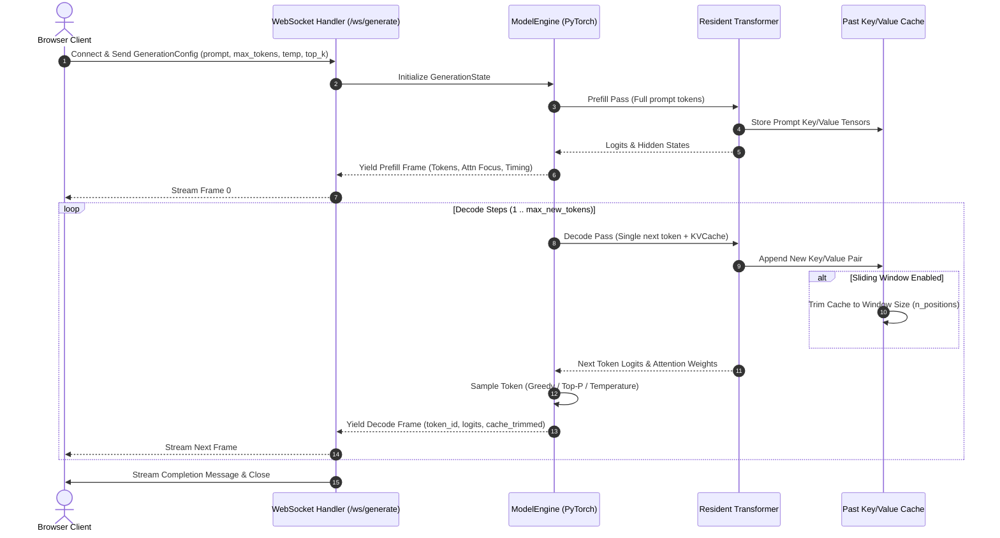

# TokenPrint — Model Execution & Autoregressive Inference Pipeline

**Status:** Current Production Pipeline  
**Execution Engine:** PyTorch CausalLM / Hugging Face Transformers  
**Inference Modalities:** Causal LM, Speculative Decoding, Sliding-Window Attention, GGUF  

---

## 1. Inference Engine Lifecycle

TokenPrint's `ModelEngine` manages the resident machine learning model, weights memory allocation, forward pass hook attachment, and real-time generation loop.

---

## 2. Autoregressive Streaming & KV Cache Tracking

Autoregressive generation is exposed over WebSocket (`/ws/generate`), yielding rich frame-by-frame diagnostic metadata:

---

## 3. Speculative Decoding Instrumentation

TokenPrint natively instruments speculative decoding runs:
- **Draft Proposals**: Identifies speculative token sequences emitted by a draft model.
- **Verification Pass**: Tracks parallel target model verification across draft positions.
- **Acceptance Rate**: Calculates $\alpha = \frac{N_{\text{accepted}}}{N_{\text{draft}}}$ per generation batch.
- **Styling Annotations**: Emits `.tok.gen.draft` and `.tok.gen.target` styling markers for 3D and DOM visualization.

---

## 4. Execution Pipeline Capability Inventory

| Capability | Status | Implementation Details |
| :--- | :--- | :--- |
| **Prefill Pass** | `IMPLEMENTED` | Full prompt ingested in parallel; captures prompt attention matrix. |
| **Decode Pass** | `IMPLEMENTED` | Sequential next-token sampling with KV cache reuse. |
| **Sliding Window** | `IMPLEMENTED` | FIFO key/value eviction when sequence exceeds `window_size`. |
| **Needle-in-Haystack** | `IMPLEMENTED` | Tracks specific fact tokens to observe eviction from sliding cache. |
| **Speculative Verification** | `IMPLEMENTED` | Draft vs target token categorization with acceptance metrics. |
| **Dynamic Quantization** | `EXPERIMENTAL` | GGUF quantization via `llama-cpp-python` (metadata verified). |
| **Batched Multi-User** | `PARTIALLY IMPLEMENTED`| Single-request concurrency supported; multi-request queued via locks. |
