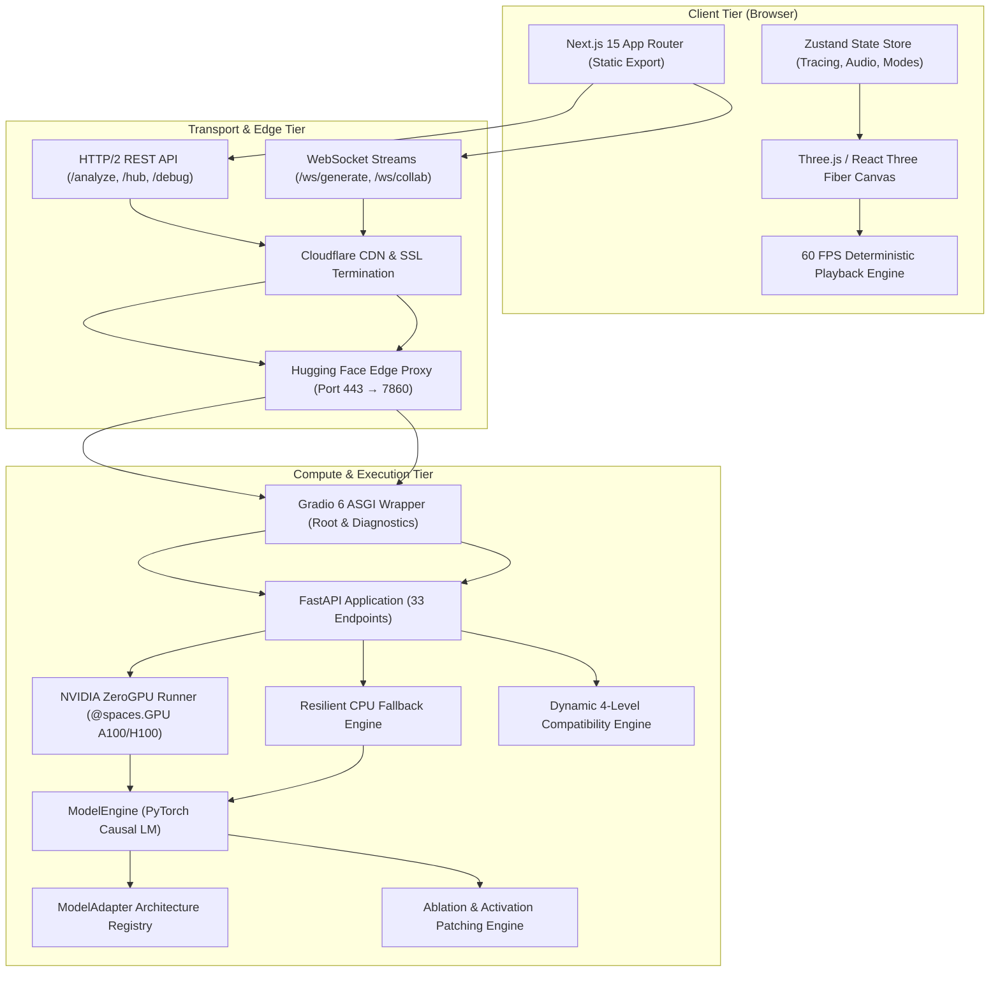

# TokenPrint — System Architecture Overview

**Status:** Current Production Architecture  
**Auditor / Architect:** Senior ML Systems & Web Performance Architect  
**Repository:** [TokenPrint (NeuroScope)](https://github.com/Sudharsanselvaraj/Token-Print)  
**Last Verified:** November 2026  

---

## 1. System Vision & Purpose

TokenPrint is a production-grade, open-source mechanistic interpretability and 3D visualization platform for transformer language models. Rather than treating neural networks as opaque black boxes, TokenPrint extracts, projects, and visually animates every forward pass tensor — tokens, embeddings, Q/K/V attention projections, residual stream trajectories, MLP activations, and unembedding logits — with absolute data honesty.

> [!IMPORTANT]
> **Data Honesty Invariant**: Every number, coordinate, probability distribution, and attention weight displayed in TokenPrint is directly computed from live PyTorch tensor execution or a validated deterministic execution trace. Zero mock values, zero decorative random noise.

---

## 2. High-Level System Architecture

TokenPrint operates across three primary tiers:

---

## 3. Subsystem Inventory & Implementation Status

| Subsystem | Component | Implementation Status | Implementation Details |
| :--- | :--- | :--- | :--- |
| **Model Serving** | Causal LM Forward Pass | **IMPLEMENTED** | Native PyTorch forward pass with `output_hidden_states=True` and `output_attentions=True`. |
| **Model Serving** | Streaming Generation | **IMPLEMENTED** | WebSocket token-by-token emission with KV cache tracking and speculative decoding. |
| **Model Serving** | ZeroGPU Acceleration | **IMPLEMENTED** | Dynamic `@spaces.GPU(duration=60)` runner with automated resilient CPU fallback. |
| **Model Serving** | GGUF / llama.cpp | **EXPERIMENTAL** | Metadata inspection implemented; inference requires optional `llama-cpp-python` wheel. |
| **Discovery** | Hugging Face Hub Search | **IMPLEMENTED** | Server-side `/api/hub/models` with pagination, sorting, caching, and client fallback. |
| **Discovery** | Compatibility Engine | **IMPLEMENTED** | 4-level evaluation (`DISCOVERABLE` to `ADVANCED`) across 12 discrete capabilities. |
| **Discovery** | VRAM Estimation | **IMPLEMENTED** | Parameter count extraction, dtype weighting, and hardware feasibility scoring. |
| **Interpretability**| Attention Matrix Capture| **IMPLEMENTED** | Multi-head attention matrices per layer across Q/K/V heads. |
| **Interpretability**| Residual Stream Trace | **IMPLEMENTED** | 3D PCA projection (`project_3d`) of layer-by-layer hidden state vectors. |
| **Interpretability**| Logit Lens | **IMPLEMENTED** | Intermediate layer projection onto unembedding matrix with RMSNorm scaling. |
| **Interpretability**| Head Ablation | **IMPLEMENTED** | Targeted zeroing of attention head outputs via forward pre-hooks. |
| **Interpretability**| Layer Ablation | **IMPLEMENTED** | Intermediate transformer block bypass via residual identity pass-through. |
| **Interpretability**| Activation Patching | **IMPLEMENTED** | Prompt swap clean-vs-corrupted activation replacement via PyTorch hooks. |
| **Collaboration** | Multi-Peer Room Sync | **IMPLEMENTED** | `/ws/collab/{room_id}` real-time presence, 3D cursor broadcasting, and role authority. |
| **Frontend** | Spatial 3D Architecture | **IMPLEMENTED** | Canonical op graph (`arch3d`), node positioning, and animated token packets. |
| **Frontend** | Multimodal Audio Sonification| **IMPLEMENTED**| Web Audio API synthesis mapped to attention entropy and token confidence. |
| **Deployment** | Hugging Face Spaces | **IMPLEMENTED** | Public space `sudharsan112321/tokenprint-backend` running on `zero-a10g`. |
| **Deployment** | Docker Container | **PLANNED** | Container specification drafted; currently deployed natively via Gradio SDK. |

---

## 4. Architectural Invariants & Guarantees

1. **Deterministic Coordinate Space**: 3D positions in the computational field are computed via standard canonical layouts (`ArchitectureLayout.ts`) ensuring consistent spatial landmarks across all browser sessions.
2. **Graceful Degradation**: If GPU resources are exhausted or ZeroGPU quota is exceeded, TokenPrint automatically shifts to CPU execution without aborting the client connection.
3. **SSRF Hardening**: Outbound network requests to the Hugging Face Hub are mediated through `safe_urlopen`, strictly validating domains and preventing loopback or internal metadata exploitation.
